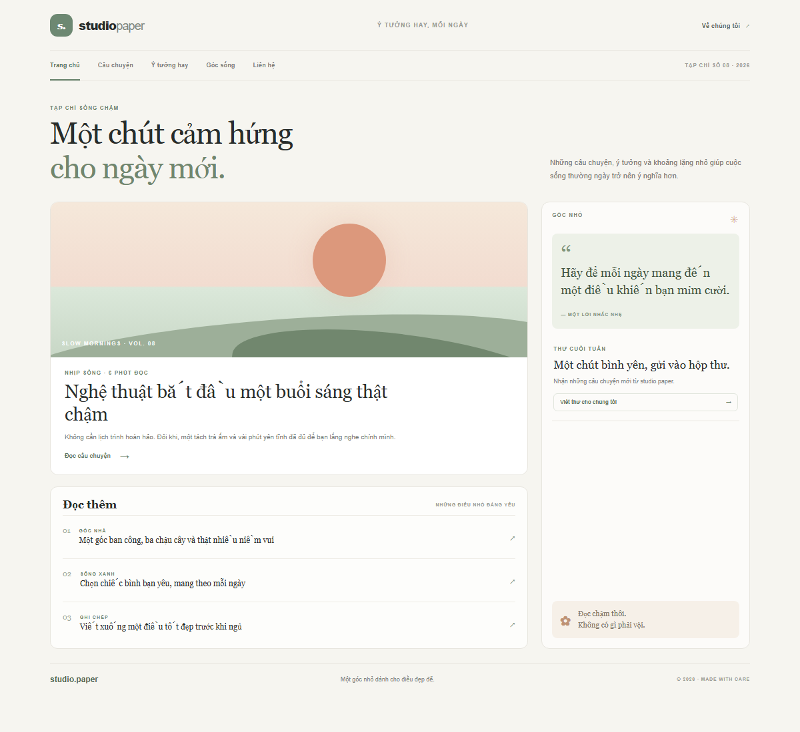
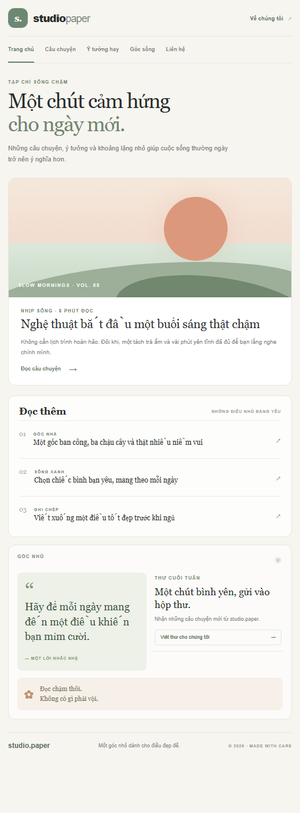

# Bố cục website responsive với CSS Flexbox

Trang mẫu dùng Flexbox để sắp xếp header và navigation; `main-container` tạo hai cột content/sidebar trên desktop. Media query đổi phần nội dung chính sang một cột trên điện thoại.

## Chạy bài

Mở `index.html` trong trình duyệt; không cần cài đặt thư viện.

## Ảnh kết quả

### Desktop

### Mobile

